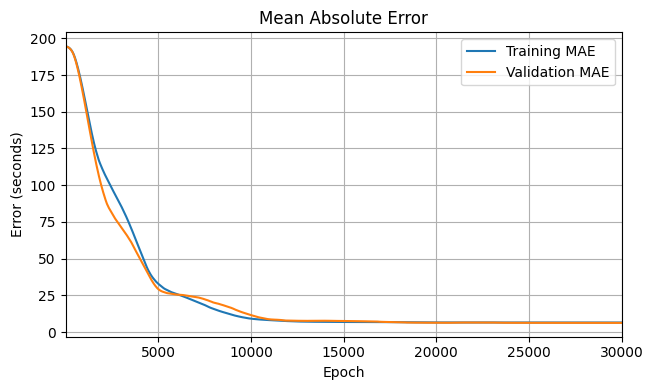
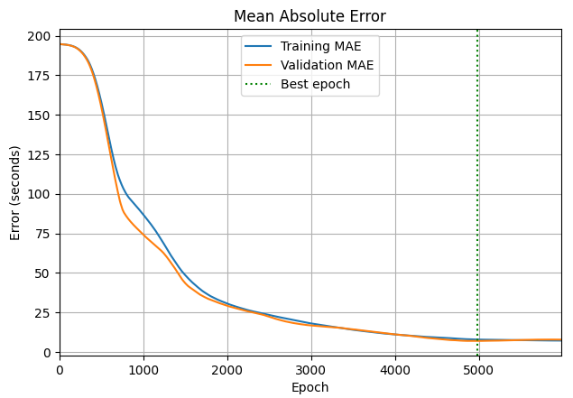
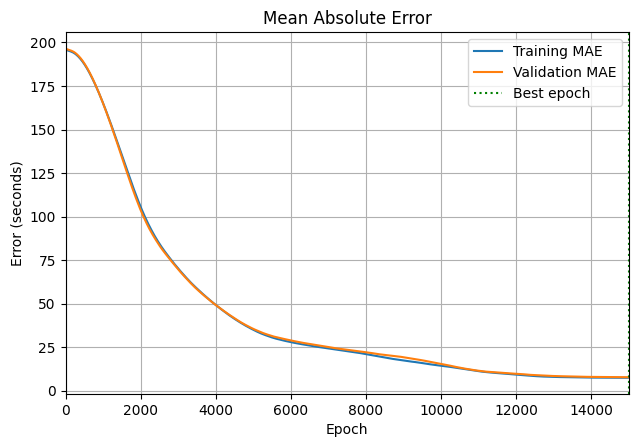

# Aircraft arrival-time prediction

**A hands-on machine learning project that predicts how many seconds an approaching aircraft needs to reach a runway's landing threshold.** It combines real ADS-B flight observations, data preprocessing and small PyTorch neural networks.

Each example is one aircraft approach. The inputs describe the aircraft when it is first confirmed to be aligned with the runway: position, altitude, speed, direction and distance to the threshold. The target, `remaining_time_s`, is the time from that snapshot to estimated threshold crossing, before touchdown.

Use this repo to learn how to prepare flight data, split it without mixing flights between partitions, scale features, train a regression model and compare its errors with a simple distance/speed estimate.

## Where is the data?

The prepared CSV files and their schemas are included in the training folders. **You can run the training notebooks without downloading the large raw datasets.**

| Dataset | Ready-to-use data | Input schema | What it contains |
| --- | --- | --- | --- |
| Original exercise | [194_airplanes/training.csv](training/194_airplanes/training.csv) | [11 features](training/194_airplanes/schema.json) | 194 approaches to Amsterdam Schiphol runway 18R on 15 March 2023. Used by notebooks 01 and 02. |
| Expanded dataset | [2596_airplanes/training.csv](training/2596_airplanes/training.csv) | [16 features](training/2596_airplanes/schema.json) | **2,596 approaches across 46 airports and 111 runway directions.** Used by [03_more_airplanes.ipynb](training/2596_airplanes/03_more_airplanes.ipynb). |

The expanded dataset has **about 13.4 times as many approach examples** as the original: 2,596 instead of 194, an increase of 2,402. It also adds many airports and runway directions, giving the model a much wider range of approach conditions. These counts describe recorded approaches, rather than unique aircraft.

Read each folder's `schema.json` to select `feature_columns` as inputs and `target_column` as the output. Flight IDs, callsigns, timestamps and other metadata are excluded from model inputs. The expanded schema adds runway threshold coordinates, bearing, elevation and an altitude-relative-to-elevation proxy.

Both CSVs are stored **unsplit**; the notebooks create partitions in memory, grouping by `flight_id` with `random_state=42`. They fit the feature scaler on training data only.

| Dataset | Training approaches | Validation approaches | Test approaches |
| --- | ---: | ---: | ---: |
| Original (notebooks 01 and 02) | 135 | 29 | 30 |
| Expanded (notebook 03) | 1,817 | 389 | 390 |

## Training results

These are the **saved notebook results for both datasets**. MAE (mean absolute error) is the average absolute difference between predicted and target time: **6.24 seconds MAE means predictions are off by about 6.24 seconds on average**. Lower is better. An epoch is one pass through the training data.

### 01 · Original 194 approaches: one hidden layer, 11 → 8 → 1



[01_training.ipynb](training/194_airplanes/01_training.ipynb) walks through loading, inspection, splitting, scaling, training and validation. Its final saved model has **6.48 s training MAE** and **6.24 s validation MAE** after 30,000 epochs. On the 29 validation approaches, 25 predictions are within 10 seconds of the target, the largest absolute error is 21.84 seconds and the mean signed error is +0.47 seconds.

### 02 · Original 194 approaches: two hidden layers, 11 → 8 → 8 → 1



[02_two_hidden_layers.ipynb](training/194_airplanes/02_two_hidden_layers.ipynb) adds a second hidden layer and early stopping. It restores the weights from the best validation epoch, **4,980**, with **7.92 s training MAE** and **7.02 s validation MAE**. Training stops at epoch 5,980 after 1,000 epochs without improvement; the green line marks the selected epoch.

### Validation comparison: original dataset

All entries below use the same 29 validation approaches. The baseline correction is the average training-set difference between the target and the original distance/speed estimate.

| Method | Validation MAE |
| --- | ---: |
| Distance/speed baseline (`baseline_eta_s`) | 31.88 s |
| Baseline + correction learned on training data | 9.78 s |
| One hidden layer, final epoch | **6.24 s** |
| Two hidden layers, best validation epoch | 7.02 s |

The one-hidden-layer model performs best on this original validation split. These are development results from a small validation set on one runway and one day. **The 30 test approaches have not been evaluated.**

### 03 · Expanded 2,596 approaches: one hidden layer, 16 → 8 → 1



[03_more_airplanes.ipynb](training/2596_airplanes/03_more_airplanes.ipynb) trains on the larger dataset with 16 inputs and an 8-neuron hidden layer. Its saved run reaches **7.58 s training MAE** and **7.89 s validation MAE** at the best epoch, **15,000**. Early stopping did not trigger in that run. The current notebook code allows up to 30,000 epochs; the graph and numbers here come from the saved 15,000-epoch run.

Validation covers **389 approaches from 32 airports**: **279/389 predictions (71.7%) are within 10 seconds** of the target. The largest absolute error is 42.36 seconds and the mean signed error is +0.71 seconds.

| Method on the expanded validation set | Validation MAE |
| --- | ---: |
| Distance/speed baseline (`baseline_eta_s`) | 34.03 s |
| Baseline + correction learned on training data | 14.53 s |
| One hidden layer, best validation epoch | **7.89 s** |

The network reduces MAE by about **46% versus the corrected baseline** on this split. Its 7.89 s error and the original model's 6.24 s error come from different validation sets with different airport coverage, so they do not isolate the effect of adding data. The expanded experiment measures held-out flights from the same data mixture; airports may occur in both training and validation. **Its 390 test approaches remain unevaluated**, and performance at entirely unseen airports has not been established.

The images are extracted from the notebooks' saved outputs, keeping only the MAE panels. The complete loss curves and prediction diagnostics remain in the notebooks. To refresh the README images after saving a new run, use [scripts/export_readme_plots.py](scripts/export_readme_plots.py).

## Run the notebooks

Use **Python 3.12** and VS Code with its Python and Jupyter extensions, or an existing Jupyter environment. The repository's NumPy pin is 1.26.4; the documented training environment uses Python 3.12 and CPU PyTorch 2.8.0.

From the repository root in PowerShell:

```powershell
py -3.12 -m venv training/.venv
.\training\.venv\Scripts\python.exe -m pip install --upgrade pip
.\training\.venv\Scripts\python.exe -m pip install torch==2.8.0 --index-url https://download.pytorch.org/whl/cpu
.\training\.venv\Scripts\python.exe -m pip install -r requirements.txt
.\training\.venv\Scripts\python.exe -m pip check
.\training\.venv\Scripts\python.exe -m ipykernel install --user --name aircraft-training --display-name "Aircraft training (Python 3.12)"
```

1. Open [01_training.ipynb](training/194_airplanes/01_training.ipynb) and select **Aircraft training (Python 3.12)** as the kernel.
2. Run the cells in order, or choose **Run All**. The notebook loads the original CSV, selects the schema's features, creates the partitions, scales the inputs and trains the model.
3. Open [02_two_hidden_layers.ipynb](training/194_airplanes/02_two_hidden_layers.ipynb) to compare the second architecture. It runs independently, recreates the same split and saves `02_two_hidden_layers_best.pt` beside the notebook, including model weights, feature order and scaler parameters.
4. Open [03_more_airplanes.ipynb](training/2596_airplanes/03_more_airplanes.ipynb) to train on all 2,596 approaches using the same kernel. It creates its own expanded-data partitions and saves `03_more_airplanes_best.pt` beside that notebook, including weights, feature order and scaler parameters.

All three notebooks already contain saved outputs for reading without running training. Exact installed package versions for the existing environment are recorded in [requirements.lock.txt](training/194_airplanes/requirements.lock.txt).

### Use the expanded dataset

Start with [03_more_airplanes.ipynb](training/2596_airplanes/03_more_airplanes.ipynb), which loads the expanded CSV and checks for the 16-feature schema. For a separate experiment, you can load the same data from the repository root:

```python
import json
from pathlib import Path
import pandas as pd

data_dir = Path("training/2596_airplanes")
schema = json.loads((data_dir / "schema.json").read_text())
df = pd.read_csv(data_dir / "training.csv")
X = df[schema["feature_columns"]]
y = df[schema["target_column"]]
```

Build the network's input size from `len(schema["feature_columns"])` (16 here). Create flight-grouped partitions before fitting a scaler. For experiments about future flights or new airports, use time-based or held-out-airport evaluation as appropriate. Notebooks 01 and 02 continue to load the original dataset; notebook 03 loads the expanded dataset.

## Where does the data come from?

The original exercise uses the Dorbolo/Pretto/Giannattasio OpenSky flight dataset for Schiphol on 15 March 2023. The expanded table combines accepted approaches from that source, PRC 2024 trajectories for selected weeks in January, June and September 2022, and PRC 2025 ADS-B flights. Its actual coverage and source counts are in [dataset_summary.json](training/2596_airplanes/dataset_summary.json) and [coverage.csv](training/2596_airplanes/coverage.csv).

The preprocessing pipeline cleans observations, finds confirmed runway alignment, interpolates a later threshold crossing and checks for landing continuation. It exports a snapshot and target for each accepted approach. Future observations are used to construct and audit labels; they must not become model inputs.

| Location | Contents |
| --- | --- |
| `training/194_airplanes/`, `training/2596_airplanes/` | Prepared CSVs and schemas for training. |
| `data_preprocessing/data/raw/` | Downloaded source archives and flight files; local, ignored by Git. The original source is `EHAM_20230315_flights.parquet`. |
| `data_preprocessing/prepared/` | Generated original dataset, label audits, trajectory excerpts and offline `viewer.html`; local, ignored by Git. |
| `data_preprocessing/prepared/multi_airport/` | Generated expanded dataset and detailed extraction/audit outputs; local, ignored by Git. |
| [data_preprocessing/config/sources.json](data_preprocessing/config/sources.json) | Source download URLs, local paths and checksums. |

For downloading sources, rebuilding the expanded table or adding dates and airports, follow the [expansion guide](data_preprocessing/EXPANSION.md). For the original pipeline and flight viewer, see [data_preprocessing/README.md](data_preprocessing/README.md). Training does not require rebuilding these outputs.

This is practice data with interpolated ADS-B labels. Position noise, uncorrected pressure altitude, inferred units in one source and uncertain historical runway geometry affect its accuracy. Source attribution and detailed limitations are recorded in the [original data notes](data_preprocessing/docs/data_README.md) and [expanded data guide](data_preprocessing/EXPANSION.md#sources-and-quality).

## Repository map

```text
training/
  194_airplanes/       Original CSV, schema and both training notebooks
  2596_airplanes/      Expanded CSV, schema, notebook 03 and coverage summaries
data_preprocessing/   Source acquisition, cleaning, labels and flight viewer
docs/images/          MAE graphs extracted from the saved notebooks
scripts/              README graph export helper
requirements.txt      Training/notebook dependencies
```

See the [training workspace guide](training/README.md) for dataset-specific instructions. The [pipeline audit summary](data_pipeline_summary/README.md) describes the earlier single-airport implementation; use the expansion guide for the current multi-airport pipeline.
